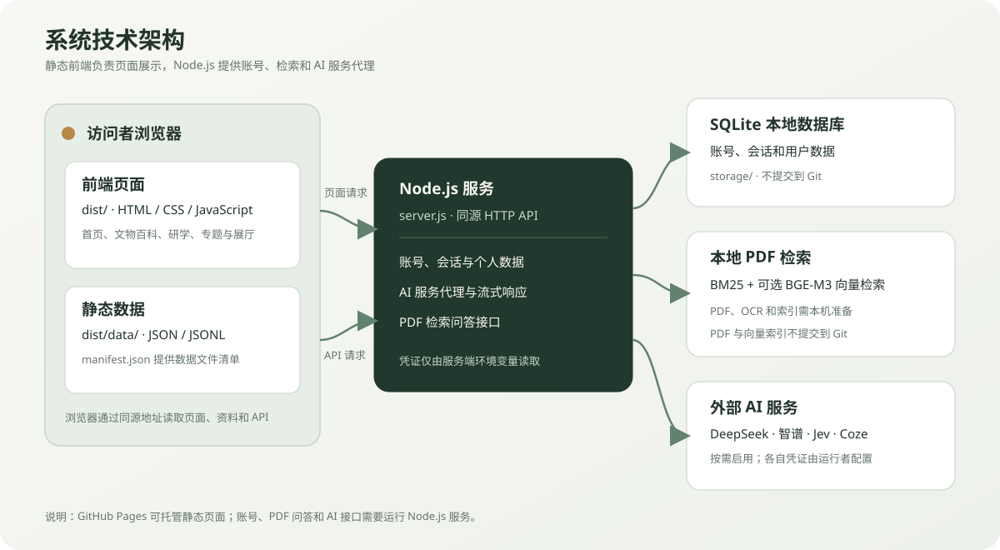

# 三星堆 · 古蜀文明数字探索平台

一个以三星堆考古资料为线索的交互式文化探索网站。项目包含文物档案、考古时间线、研学互动、专题叙事、数字展厅和账号系统，并提供可选的 AI 导览与 PDF 问答服务。

## 项目要求

| 要求项   | 项目说明                                                       |
| -------- | -------------------------------------------------------------- |
| 项目介绍 | 通过来源可追溯的文物与考古资料，支持浏览、筛选、比较和主题学习 |
| 技术架构 | 原生 HTML/CSS/JavaScript 前端，Node.js 后端，SQLite 本地数据库 |
| 安装运行 | 提供静态预览和完整后端两种本地运行方式                         |
| 环境配置 | 通过 .env.example 提供配置模板；密钥和本地数据库不提交         |

## 功能模块

| 页面       | 入口                               | 内容                                                     |
| ---------- | ---------------------------------- | -------------------------------------------------------- |
| 首页       | /                                  | 文明导读、文物精选、研学入口和 AI 导览                   |
| AI 导览    | 首页 AI 入口与导览抽屉             | 调用 Jev 识别站内页面目标并引导跳转；不承担 PDF 资料问答 |
| 文物百科   | /?page=artifacts                   | 搜索、筛选、排序、列表/网格浏览和档案详情                |
| 考古时间线 | /?page=timeline                    | 按类别查看发现、发掘、研究与保护事件                     |
| 坑位探索   | /?page=graph                       | 浏览遗址、祭祀坑、事件和相关文物资料                     |
| 资料问答   | /?page=qa                          | 基于本地 PDF 语料检索证据并生成回答                      |
| 专题展览   | /?page=stories                     | 阅读专题叙事及实体展览资料                               |
| 研学中心   | /?page=learning&path=origins 等    | 发现与命名、年代框架、坑位器物、工艺与金沙               |
| 互动考古   | /?page=fieldwork                   | 逐层观察的考古体验示意                                   |
| 数字展厅   | /?page=ai-exhibition&room=foyer 等 | 五个主题空间、创作工作流和器物回响                       |
| 账号       | /?page=login、/?page=account       | 注册登录、密码管理及个人数据管理。                       |

## 技术架构



- 前端：原生 HTML、CSS、JavaScript；静态页面与数据镜像位于 dist/。
- 后端：Node.js 内置 HTTP 服务负责 API、账号、会话、数据隔离和外部 AI 服务代理。
- 数据库：SQLite 文件保存在 storage/，由服务端按需初始化，不作为网站静态资源公开。
- PDF 问答：LangChain 组织检索与回答；BM25 可作为关键词检索回退，本地 BGE-M3 可提供向量检索。
- 外部服务：DeepSeek 或智谱用于文本生成，Jev 用于站内导航意图识别，Coze 用于数字展厅工作流。各服务密钥只在服务端配置。

## 环境要求

| 项目     | 要求                                                  |
| -------- | ----------------------------------------------------- |
| Node.js  | 22.5 或更新版本；账号数据库使用内置 node:sqlite       |
| npm      | 随 Node.js 安装                                       |
| Python   | 仅在运行 PDF OCR/索引流程时需要                       |
| Poppler  | PDF 导入和渲染工具；需要 pdfinfo、pdftotext、pdftoppm |
| BGE-M3   | 可选；用于本地向量检索。缺少时可回退关键词检索        |
| API 密钥 | 按需配置；静态预览和基础浏览不需要 AI 密钥            |

## 本地运行

### 静态页面预览

在项目目录运行：

```powershell
py -m http.server 4173 --directory dist
```

打开 http://127.0.0.1:4173/。此方式仅提供静态页面，账号、RAG、Jev 和 Coze 等需要后端的接口不可用。

### 启动完整本地服务

克隆仓库后，在项目目录运行：

```powershell
Copy-Item .env.example .env
notepad .env
npm install
npm start
```

将 .env 中需要的密钥换成运行者自己的凭证。服务默认地址为 http://127.0.0.1:4174/。启动 Node.js 服务会同时提供静态前端和同源 API。

.env.example 只包含配置名和非敏感默认值，不包含可用密钥。.env 已加入 Git 忽略规则，切勿将密钥直接写入浏览器代码、dist/ 或提交历史。

### 配置服务密钥

- DeepSeek：设置 DEEPSEEK_API_KEY；可选设置 DEEPSEEK_MODEL 与 DEEPSEEK_BASE_URL。
- 智谱：设置 ZHIPU_API_KEY 和 ZHIPU_TEXT_MODEL；可选设置 ZHIPU_BASE_URL。它可作为文本模型回退，也用于部分讲解功能。
- Jev：设置 JEV_API_KEY；兼容 TYPESAFE_API_KEY。可选设置 JEV_MODEL。
- Coze：设置 COZE_API_TOKEN 和 COZE_WORKFLOW_ID。静态预览不支持 Coze 工作流。
- 账号：SANXINGDUI_ALLOW_REGISTRATION 默认开启。SANXINGDUI_DATABASE_PATH 可更改数据库文件位置。

首次创建管理员账号时，可在启动服务前通过安全输入设置用户名和密码：

```powershell
$env:SANXINGDUI_INITIAL_USERNAME = Read-Host '初始用户名'
$securePassword = Read-Host '初始密码（至少 10 位）' -AsSecureString
$passwordPointer = [Runtime.InteropServices.Marshal]::SecureStringToBSTR($securePassword)
try { $env:SANXINGDUI_INITIAL_PASSWORD = [Runtime.InteropServices.Marshal]::PtrToStringBSTR($passwordPointer) }
finally { [Runtime.InteropServices.Marshal]::ZeroFreeBSTR($passwordPointer) }
npm start
```

初始化后停止服务并清除这两个临时环境变量。数据库文件保留在本机；不要把真实用户数据库提交到 GitHub。

## PDF 问答配置

PDF 和检索产物不在仓库中。将有权使用的 PDF 放入仓库旁的 pdf/ 目录，或通过 RAG_PDF_DIR 指定本地目录。BGE-M3 默认路径为仓库旁的 models/bge-m3，可通过 RAG_EMBEDDING_MODEL_PATH 修改。

首次导入或更新 PDF 后运行：

```powershell
npm run ingest:pdf
npm run ocr:pdf
npm run index:pdf
```

OCR 需要安装 requirements-ocr.txt 中的 Python 包；PDF 导入和页面渲染需要 Poppler。运行流程会在本地生成检索语料和向量索引，这些产物受 .gitignore 保护，不会进入提交。OCR 结果仍需对照原 PDF 复核。上传或处理 PDF 前，确认拥有相应的使用权限。

## 数据与目录

```text
.
├── assets/                 展厅源图片
├── data/                   结构化资料、来源与媒体登记
├── dist/                   网站前端、静态数据镜像和发布资源
├── rag/                    RAG 代码、文档登记及本地检索产物
├── scripts/                数据导入、OCR、索引与构建脚本
├── tests/                  项目测试文件
├── auth-store.js           账号、会话与 SQLite 数据访问
├── learning-assistant-core.js
├── server.js               Node.js 服务入口
├── .env.example            环境变量模板
└── package.json            npm 依赖和脚本
```

结构化网页资料以 data/ 为源目录，dist/data/ 为静态镜像。dist/data/manifest.json 登记可读取文件的路径、格式和记录数。更新网站数据镜像可运行：

```powershell
py scripts/build_web_data_bundle.py
```

## 项目团队

- 团队名称：电工不秃队
- 曾华：前端开发，负责网站页面、交互效果和响应式适配。
- 陈轩：后端开发，负责 Node.js 服务、账号与数据接口，以及 AI/RAG 服务接入。
- 彭靖贻：资料整理，负责考古资料收集、结构化录入、来源登记和内容核对。

## 许可与致谢

本项目使用原生 Web 技术、LangChain 与 Three.js 等组件。第三方依赖的许可证文件随依赖目录保留。项目数据、图片、视频和模型具有各自不同的来源与使用条件；本仓库不授予第三方素材的额外使用权。

## 维护说明

新增数据时保留稳定 ID、来源链接、页码定位、记录状态和权利状态。变更页面路由、环境变量或运行步骤时，同步更新本 README 与 .env.example。
